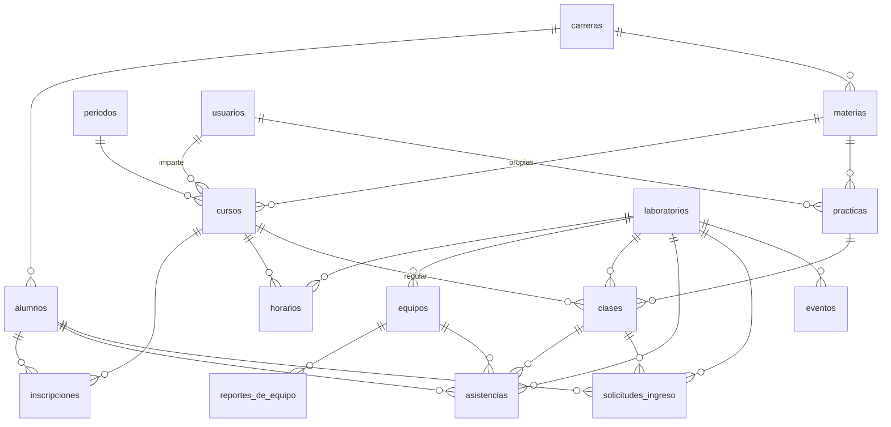

# Modelo de datos

La base se define en [`db/esquema.sql`](../db/esquema.sql). Los catálogos con los que arranca están en [`db/datos-iniciales.sql`](../db/datos-iniciales.sql).

Este esquema sustituye al `schema.sql` del sistema original y a las migraciones 001 y 002 que se le agregaron para seguir la forma de los documentos de Firebase. Esos archivos ya no están en el repositorio.

Funciona igual en **MySQL 8.0** y en **MariaDB 10.6** o más nuevo. Se prueba en los dos porque no sabemos cuál dará Hostinger.

## Las tablas

| Grupo | Tabla | Qué guarda |
|---|---|---|
| Catálogos | `laboratorios` | Los laboratorios, con su clave corta (`programacion`) |
| | `carreras` | Las carreras del instituto |
| | `periodos` | Los semestres escolares, con sus fechas |
| Personas | `usuarios` | Cuentas del personal: administrador, laboratorista y docente |
| | `alumnos` | Alumnos, con su número de control; no tienen cuenta |
| Materias | `materias` | La materia en sí: nombre, clave, carrera y semestre |
| | `cursos` | Una materia que un docente imparte a un grupo en un periodo |
| | `inscripciones` | Qué alumnos llevan cada curso y desde cuándo |
| | `practicas` | Las prácticas de cada materia: comunes a todos sus docentes o propias de uno |
| | `horarios` | En qué laboratorio, qué día y a qué hora se imparte cada curso |
| Equipos | `equipos` | Las computadoras de cada laboratorio |
| | `reportes_de_equipo` | Cada falla reportada y su seguimiento |
| Operación | `clases` | Cada sesión en un laboratorio, regular o de maestro invitado |
| | `asistencias` | Cada entrada a un laboratorio, en clase o fuera de ella, con su salida |
| | `solicitudes_ingreso` | Alumnos que piden entrar a una clase en la que no están inscritos, o usar el laboratorio fuera de clase |
| Otros | `eventos` | Talleres y actividades del laboratorio fuera de clase |
| | `avisos` | Avisos para el administrador y el laboratorista |
| | `bitacora` | Quién hizo qué, cuándo y desde dónde |
| | `migraciones` | Qué cambios posteriores a la base ya se aplicaron |

## Cómo queda un alumno en la lista de una clase

El alumno no se da de alta ni se inscribe: todo lo carga el personal antes de que haya clase.

1. **El administrador o el laboratorista da de alta a los alumnos** (`alumnos`), normalmente desde un Excel al inicio del semestre, con número de control, nombre, carrera, semestre y grupo.
2. **El administrador crea el curso** (`cursos`): materia, grupo, docente y periodo.
3. **El personal o el docente del curso lo llena** (`inscripciones`), pegando la lista de números de control.
4. **El docente abre la clase** (`clases`) en el laboratorio.
5. **El alumno escribe su número de control** y elige su computadora. La API lo busca en `alumnos`, revisa que esté en `inscripciones` de ese curso y crea su fila en `asistencias`.

Si el alumno no está inscrito, puede pedir permiso (`solicitudes_ingreso`). El administrador lo deja entrar esa vez o lo inscribe en el curso. La inscripción también sirve para saber quién faltó: sin ella solo se sabría quién vino.

El sistema original hacía la misma revisión con la lista de materias guardada en cada alumno de Firebase. Si el instituto prefiere que cualquier alumno entre a cualquier clase, es la pregunta 10 de [preguntas-para-el-instituto.md](preguntas-para-el-instituto.md).

## Qué cambia respecto de la base anterior

| Antes | Problema | Ahora |
|---|---|---|
| La "materia" era a la vez la materia, el docente, el semestre y el ciclo escolar | Cada semestre había que crear materias nuevas a mano, y no se distinguía una materia de un grupo | `materias` es el catálogo; `cursos` une materia, grupo, docente y periodo |
| Las inscripciones eran una lista JSON dentro de cada alumno | La base no podía responder quién lleva una materia, así que la pantalla de asistencia descargaba todos los alumnos al navegador. Al borrar una materia, los alumnos seguían apuntando a ella. Las inscripciones nunca se reiniciaban | Tabla `inscripciones`, por curso y con la fecha de inscripción. Las faltas se cuentan desde esa fecha |
| Carrera, semestre y turno eran texto libre | Las pantallas ya escribían la misma carrera de formas distintas ("Ingenieria en sistemas computacionales" e "Ingeniería en Sistemas Computacionales"), y los reportes no las juntan | Catálogo `carreras`; semestre como número del 1 al 15; turno `matutino` o `vespertino` |
| Tres tablas de personal (`docentes`, `laboratoristas`, `administradores`), cada una con su forma | Lógica de inicio de sesión repetida tres veces | Una tabla `usuarios` con `rol` |
| `asistencias` (las de ahora) y `asistencias_historico` (las pasadas), con los datos del alumno copiados | Al salir, cada fila se copiaba de una tabla a otra; una falla a la mitad dejaba datos a medias | Una sola tabla `asistencias`: la fila es la misma antes y después de la salida (`hora_salida`) |
| El equipo guardaba `en_uso` y `usuario_actual` | Podía decir "ocupado" sin que nadie lo estuviera, si algo fallaba al liberarlo | Se deduce de que haya una asistencia abierta con ese equipo |
| El equipo propio era una fila especial `personal` en cada laboratorio | Casos especiales en todo el código | `equipo_id` vacío en la asistencia |
| El estado de reparación se sobrescribía en el equipo | No quedaba el historial de fallas de cada computadora | `reportes_de_equipo`: cada falla con su descripción, quién la reportó, su estado y cuándo se resolvió |
| Las prácticas eran de la "materia" de cada docente, con duración en texto | Había que recapturarlas cada semestre, y la duración no se podía sumar | Son de la materia y se reusan cada semestre. Pueden ser comunes o propias de un docente. Duración en minutos |
| El horario solo vivía en la pantalla | Se perdía al recargarla | Tabla `horarios` |
| Los avisos copiaban sus datos en JSON | Mostraban un estado viejo: un equipo ya reparado seguía apareciendo descompuesto | El aviso apunta a la solicitud, el reporte o la clase, y la pantalla muestra su estado actual |
| Casi ninguna llave foránea (solo prácticas → materias) | Al borrar un docente, sus materias apuntaban a nadie | Llaves foráneas en todas las relaciones |
| Fechas con `TIMESTAMP` | Convierte las horas según la zona de cada conexión: en MySQL 8, una conexión distinta leía la bitácora con 7 horas de diferencia | `DATETIME` en hora de Puerto Peñasco |
| Se borraban docentes, alumnos y materias | Se perdía el historial de asistencias de lo borrado | Lo que tiene historial se desactiva (`activo`); solo se borra lo que no se ha usado |

## Reglas que garantiza la base

Además de que la API las revise, la base rechaza lo que las rompe, aunque lleguen dos peticiones al mismo tiempo.

**Clases**
- En un laboratorio hay a lo más una clase abierta de cada tipo (regular o de maestro invitado).
- Un curso no puede estar abierto en dos laboratorios a la vez.
- La clase regular tiene curso; la de maestro invitado tiene la materia escrita a mano y no tiene curso.
- Toda clase cerrada dice cómo se cerró.

**Asistencias**
- Un equipo tiene a lo más un ocupante, y un alumno o un usuario no puede estar dentro dos veces a la vez.
- La clase y el equipo de una asistencia son del mismo laboratorio que la asistencia.
- La asistencia es de un alumno, de un usuario o de un invitado con nombre, nunca de una mezcla.
- Una entrada fuera de clase la registró alguien del personal o la autorizó una solicitud.
- La salida no puede ser anterior a la entrada.

**Solicitudes**
- La clase y el equipo de una solicitud son de su laboratorio.
- Hay a lo más una pendiente por alumno, laboratorio y clase.
- La que está resuelta tiene fecha de resolución.
- Solo se aprueba inscribiendo al alumno si es de una clase, porque fuera de clase no hay curso.

**Sin repetir**
- Un curso (materia, periodo y grupo).
- Una inscripción.
- Una cuenta en el mismo rol.
- La etiqueta de un equipo activo en su laboratorio.
- El número de una práctica activa en su lista.

**Valores válidos**
- Semestres del 1 al 15.
- Periodos que terminan después de empezar.
- Horarios de lunes a sábado, con fin posterior al inicio.

**Historial**
- No se puede borrar lo que tiene historial, como un alumno con asistencias o un curso con clases: se desactiva.

Todas se comprobaron intentando romperlas (35 casos) en MariaDB 11.5 y en MySQL 8.0.

## Qué se tomó del diseño de la versión .NET

Antes de pasar a PHP diseñamos una base para la API en .NET (repositorio `Sistema_asignacion_academica_ITSPP`, `db/esquema.sql`). Este esquema parte de ese diseño. Se tomó casi todo:

- **Estructura:** los catálogos de carreras, periodos y laboratorios; materias separadas de cursos; inscripciones como tabla.
- **Personas y asistencias:** una sola tabla de cuentas con rol, y una sola tabla de asistencias en la que la ocupación de los equipos se deduce.
- **Reglas en la base:**
  - Índices únicos que solo cuentan las filas abiertas, para impedir dos clases abiertas o dos ocupantes en un equipo.
  - Llaves compuestas, para que el equipo sea del laboratorio de la asistencia.
  - Lo que tiene historial se desactiva en lugar de borrarse.
- **El uso del laboratorio fuera de clase:** asistencias y solicitudes sin clase.
- **Prácticas por materia** para no recapturarlas cada semestre, con la duración en minutos.
- **El comentario al resolver una solicitud.**
- **El código de clase,** que era la medida prevista por si el sistema quedaba en internet.
- **Los 25 equipos del laboratorio de programación** en los datos iniciales.

Se cambió esto, por lo que hace el sistema actual:

| En el diseño .NET | Ahora | Por qué |
|---|---|---|
| Una sola clase abierta por laboratorio, siempre de un curso | Una regular y una de maestro invitado | El sistema actual tiene clases de maestro invitado, a las que entra gente de fuera |
| Prácticas de la materia, compartidas por todos sus docentes | Comunes o propias de un docente | En Firebase cada docente tiene las suyas; así sirve también si el instituto responde que son comunes |
| Correo único entre todas las cuentas | Único dentro de cada rol | El inicio de sesión pide el rol, y en Firebase una persona puede tener cuenta de docente y de administrador |
| Horas en UTC | Hora de Puerto Peñasco | Un solo plantel, en una zona sin horario de verano: no hay que convertir en cada consulta |
| Inscripciones sin fecha | Con fecha | Así se corrige la limitación de contar como faltas las clases anteriores a la inscripción |
| Sin reportes de equipo, horarios, eventos ni historial de avisos | Con ellos | Son funciones del sistema actual, o (el horario) estaban a medias |

## Decisiones de diseño

- **Una cuenta por rol.** Al iniciar sesión se elige el rol, como ahora, así que la misma persona puede ser docente y administradora con el mismo correo. Lo que no se repite es el correo o la matrícula dentro de un rol.
- **Horas en hora local, no en UTC.** Ver la tabla anterior.
- **Identificadores numéricos.** La matrícula, la clave del laboratorio y la etiqueta del equipo pueden corregirse sin romper las relaciones. Las pantallas siguen usando la matrícula y la clave.
- **No se copian los datos del alumno en cada asistencia.** Los reportes toman la carrera del alumno y el grupo del curso. La contra es que, si un alumno cambia de carrera, sus asistencias pasadas salen con la carrera nueva.
- **Prácticas comunes o propias.** El docente ve las comunes de la materia y las suyas. El administrador edita las comunes y cada docente las suyas.
- **Uso fuera de clase.** Mientras el instituto no responda quién lo autoriza, se supone lo que se propone en la pregunta 5 de [preguntas-para-el-instituto.md](preguntas-para-el-instituto.md): el laboratorista lo registra sin pedir permiso a nadie. Las solicitudes fuera de clase quedan listas para cuando se defina.
- **Código de clase.** La base lo guarda; si el registro lo exige o no se decide en la pantalla de registro.

## Pendiente de confirmar con el instituto

Están en [preguntas-para-el-instituto.md](preguntas-para-el-instituto.md):
- La lista oficial de carreras y las fechas de los periodos.
- Cuántos laboratorios hay y cuántas computadoras tiene cada uno.
- Quién autoriza el uso fuera de clase.
- Si las prácticas son comunes o de cada docente; el esquema sirve para las dos respuestas.

## De Firebase a esta base

[`scripts/importar-de-firebase.php`](../scripts/importar-de-firebase.php) hace la conversión. Los pasos para correrla están en [cambio-de-firebase.md](cambio-de-firebase.md).

- **Cuentas:** las de `Administrador`, `Docentes` y `Laboratoristas` pasan a `usuarios`, con su matrícula (el id del documento) y su contraseña.
- **Carreras:** se buscan en el catálogo sin importar acentos ni mayúsculas, o como el principio del texto ("Licenciatura en Administración de Empresas" encuentra "Licenciatura en Administración"). Las que no estén se reportan para darlas de alta.
- **Materias y cursos:**
  - Cada materia de Firebase se separa en la materia del catálogo y su curso.
  - El periodo sale de su ciclo escolar: "2026-2027-1" es AGO-DIC 2026 y "2026-2027-2", ENE-JUL 2027.
  - Como Firebase no guardaba el grupo, se toma el de la mayoría de los alumnos del curso.
- **Prácticas:** quedan como propias del docente de esa materia, con la duración en minutos ("2 horas" son 120).
- **Inscripciones:** la lista de materias de cada alumno se convierte en filas de `inscripciones`, desde el inicio del periodo.
- **Equipos:** los de Firebase reemplazan a los de los datos iniciales de ese laboratorio. Su estado de reparación se vuelve un reporte de falla.
- **Clases y asistencias:**
  - `ClassInformation` se convierte en clases y asistencias ya cerradas, con su hora.
  - Las clases de maestro invitado se atribuyen a una cuenta desactivada, "Importación de Firebase", porque Firebase no guardaba quién las abrió.
  - Un alumno que aparece en el historial pero ya no estaba en Firebase se crea desactivado.
- **Solicitudes:** quedan ligadas a la clase que estaba abierta a esa hora. Las que quedaron sin resolver se marcan como rechazadas, con un comentario.
- **No se copian:** las asistencias en curso, el estado de las clases abiertas y los avisos viejos.
- **Lo que no se puede convertir sin adivinar**, como una carrera desconocida, un semestre que no es número o una duración ilegible, queda vacío, y el script lo lista al terminar.
