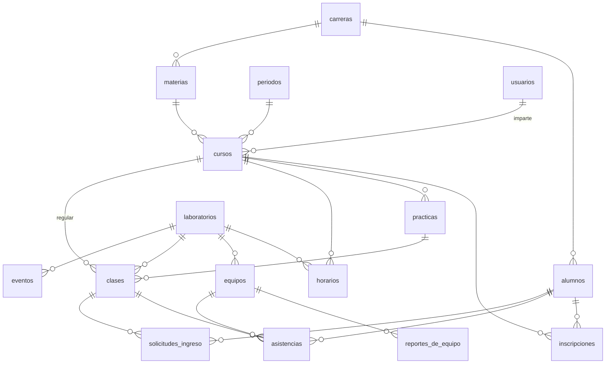

# Modelo de datos

La base se define en [`db/esquema.sql`](../db/esquema.sql), y los catálogos con los que arranca en [`db/datos-iniciales.sql`](../db/datos-iniciales.sql). Sustituye a `schema.sql` y a las migraciones 001 y 002, que se diseñaron para seguir la forma de los documentos de Firebase.

Funciona igual en **MySQL 8.0** y en **MariaDB 10.6** o más nuevo: no sabemos cuál dará Hostinger, así que se prueba en los dos.

## Las tablas

| Grupo | Tabla | Qué guarda |
|---|---|---|
| Catálogos | `laboratorios` | Los laboratorios, con su clave corta (`programacion`) |
| | `carreras` | Las carreras del instituto |
| | `periodos` | Los semestres escolares, con sus fechas |
| Personas | `usuarios` | Cuentas del personal: administrador, laboratorista y docente |
| | `alumnos` | Alumnos, con su número de control. No tienen cuenta |
| Materias | `materias` | La materia en sí: nombre, clave, carrera y semestre |
| | `cursos` | Una materia que un docente imparte a un grupo en un periodo |
| | `inscripciones` | Qué alumnos llevan cada curso, y desde cuándo |
| | `practicas` | Las prácticas de cada curso |
| | `horarios` | En qué laboratorio, qué día y a qué hora se imparte cada curso |
| Equipos | `equipos` | Las computadoras de cada laboratorio |
| | `reportes_de_equipo` | Cada falla reportada y su seguimiento |
| Operación | `clases` | Cada sesión en un laboratorio, regular o de maestro invitado |
| | `asistencias` | Cada entrada a una clase, con su salida |
| | `solicitudes_ingreso` | Alumnos no inscritos que piden entrar a una clase |
| Otros | `eventos` | Talleres y actividades del laboratorio fuera de clase |
| | `avisos` | Avisos para el administrador y el laboratorista |
| | `bitacora` | Quién hizo qué, cuándo y desde dónde |
| | `migraciones` | Qué cambios posteriores a la base ya se aplicaron |

## Qué cambia respecto de la base anterior

| Antes | Problema | Ahora |
|---|---|---|
| La "materia" era a la vez la materia, el grupo, el docente y el ciclo escolar | Al empezar otro semestre había que crear materias nuevas a mano, y no se distinguía una materia de un grupo | `materias` es el catálogo; `cursos` une materia, grupo, docente y periodo |
| Las inscripciones eran una lista JSON dentro de cada alumno | La base no podía responder quién lleva una materia, así que la pantalla de asistencia descargaba todos los alumnos al navegador. Al borrar una materia, los alumnos seguían apuntando a ella. Las inscripciones nunca se reiniciaban | Tabla `inscripciones`, por curso, con la fecha de inscripción. Las faltas se cuentan desde esa fecha, lo que corrige una limitación conocida |
| Carrera, semestre y turno eran texto libre | Las pantallas ya escribían la misma carrera de formas distintas ("Ingenieria en sistemas computacionales" e "Ingeniería en Sistemas Computacionales"), y los reportes no las juntan | Catálogo `carreras`; semestre como número del 1 al 15; turno como `matutino` o `vespertino` |
| Tres tablas de personal (`docentes`, `laboratoristas`, `administradores`), cada una con su forma | Lógica de inicio de sesión repetida tres veces | Una tabla `usuarios` con `rol` |
| `asistencias` (las de ahora) y `asistencias_historico` (las pasadas), con los datos del alumno copiados | Al salir, cada fila se copiaba de una tabla a otra; una falla a la mitad dejaba datos a medias | Una sola tabla `asistencias`: la fila es la misma antes y después de la salida (`hora_salida`) |
| El equipo guardaba `en_uso` y `usuario_actual` | Podía decir "ocupado" sin que nadie lo estuviera, si algo fallaba al liberarlo | Se deduce de que haya una asistencia abierta con ese equipo |
| El equipo propio era una fila especial `personal` en cada laboratorio | Casos especiales en todo el código | `equipo_id` vacío en la asistencia |
| El estado de reparación se sobrescribía en el equipo | No quedaba el historial de fallas de cada computadora | `reportes_de_equipo`: cada falla con su descripción, quién la reportó, su estado y cuándo se resolvió |
| Las prácticas eran de la materia | Su fecha planeada es propia de cada grupo | Son del curso; para el siguiente periodo se copian |
| El horario solo vivía en la pantalla | Se perdía al recargarla | Tabla `horarios` |
| Los avisos copiaban sus datos en JSON | Mostraban un estado viejo: un equipo ya reparado seguía apareciendo descompuesto | El aviso apunta a la solicitud, el reporte o la clase, y la pantalla muestra su estado actual |
| Casi ninguna llave foránea (solo prácticas → materias) | Al borrar un docente, sus materias apuntaban a nadie | Llaves foráneas en todas las relaciones |
| Fechas con `TIMESTAMP` | Convierte las horas según la zona de la conexión: con MySQL 8 una conexión distinta leía la bitácora 7 horas adelantada | `DATETIME` en hora de Puerto Peñasco |
| Se borraban docentes, alumnos y materias | Se perdía el historial de asistencias de lo borrado | Lo que tiene historial se desactiva (`activo`); solo se borra lo que no se ha usado |

## Reglas que garantiza la base

Además de que la API las revise, la base rechaza lo que las rompe, aunque lleguen dos peticiones al mismo tiempo:

- **Laboratorios:** una sola clase abierta de cada tipo (regular o de maestro invitado) por laboratorio.
- **Cursos:** un curso no puede estar abierto en dos laboratorios a la vez.
- **Equipos:** cada uno tiene a lo más un ocupante.
- **Personas:** un alumno o un usuario no puede estar dentro de dos clases a la vez.
- **Asistencias:**
  - Se refieren a un alumno, a un usuario o a un invitado con nombre, nunca a una mezcla.
  - La salida no puede ser anterior a la entrada.
- **Clases:**
  - La regular tiene curso.
  - La de maestro invitado tiene materia escrita a mano y no tiene curso.
  - Toda clase cerrada dice cómo se cerró.
- **Solicitudes:**
  - Una sola pendiente por alumno y clase.
  - La que ya se resolvió tiene fecha de resolución.
- **Sin repetidos:** no se repiten un curso (materia, periodo y grupo), una inscripción, la etiqueta de un equipo en su laboratorio, ni una cuenta en el mismo rol.
- **Datos válidos:**
  - Semestres del 1 al 15.
  - Periodos que terminan después de empezar.
  - Horarios de lunes a sábado, con hora de fin posterior a la de inicio.
- **Historial:** no se puede borrar nada con historial: un alumno con asistencias, un curso con clases, etc.

Todas estas reglas se comprobaron intentando romperlas en MariaDB 11.5 y en MySQL 8.0.

## Decisiones de diseño

- **Una cuenta por rol.** Al iniciar sesión se elige el rol, como ahora, así que la misma persona puede ser docente y administradora con el mismo correo. Lo que no se repite es el correo o la matrícula dentro del mismo rol. Así la importación de Firebase no choca con quien tenga dos cuentas.
- **Horas en hora local, no en UTC.** El sistema es de un solo plantel, en una zona sin horario de verano. Guardar la hora local evita conversiones en cada consulta.
- **Identificadores numéricos.** La matrícula, la clave del laboratorio y la etiqueta del equipo pueden corregirse sin romper las relaciones. Las pantallas siguen usando la matrícula y la clave del laboratorio.
- **No se copian los datos del alumno en cada asistencia.** Los reportes toman la carrera del alumno y el grupo del curso. La contra es que, si un alumno cambia de carrera, sus asistencias pasadas salen con la carrera nueva. El grupo y el semestre de la materia sí son los del curso de ese periodo.
- **Prácticas por curso.** Responde la pregunta abierta "¿las prácticas son por materia o por docente?" con lo que ya hacía el sistema: cada docente y cada grupo llevan las suyas.

## Pendiente de confirmar con el instituto

- La lista oficial de carreras y sus nombres. `datos-iniciales.sql` trae las cuatro que aparecían en las pantallas.
- Las fechas de los periodos escolares.
- Si el horario de un laboratorio debe impedir abrir una clase fuera de él. Por ahora solo se guarda y se muestra.

## De Firebase a esta base

`scripts/importar-de-firebase.php` se reescribirá para hacer esta conversión (todavía importa a la base anterior):

- **Carreras:** se buscan en el catálogo sin importar acentos ni mayúsculas. Las que no estén se reportan para darlas de alta.
- **Materias:** cada una se separa en materia y curso. El periodo sale de su ciclo escolar.
- **Inscripciones:** la lista de materias de cada alumno se convierte en filas de `inscripciones`.
- **Clases y asistencias:** `ClassInformation` se convierte en `clases` y `asistencias` cerradas.
- **Lo que no se puede convertir** sin adivinar (una carrera desconocida, un semestre que no es número) queda vacío, y el script lo lista al terminar.
